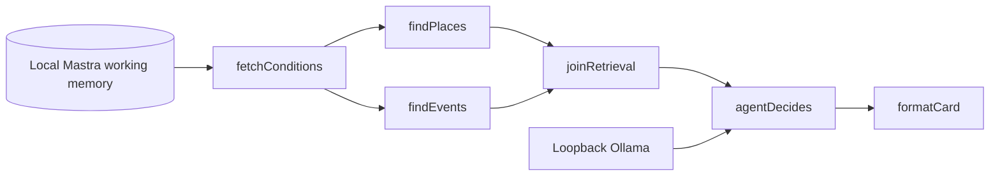

# Nikal — Your cue to step outside

Nikal means “go out” in Hindi. This small terminal agent asks: **Should I step outside today given the heat and air quality, or is tomorrow better? Where could I go?** It prints one card and stops.

Built for Gwalior, Madhya Pradesh, India, for [DEV's Touch Grass challenge](https://dev.to/challenges/hacktoberfest-week1-2026-10-05). In an Indian city, heat and air quality can make “just go outside” poor advice at the wrong hour.

## Start on macOS / zsh

Node **24.14.0** was detected and tested; Mastra requires **≥22.13.0**. Exact commands and the distinction between executed and remaining steps are in [SETUP.md](SETUP.md).

```zsh
cd /Users/jashanpreetkaur/Desktop/Nikal
npm ci
cp .env.example .env       # first setup only; preserve an existing key/config
NIKAL_SKIP_DOTENV=1 npm run check
```

Ollama is already installed on the development laptop. If missing, download it from [Ollama's macOS page](https://ollama.com/download/mac), or install the Homebrew formula with `brew install ollama`. Run the server in a separate terminal if it is not already running:

```zsh
OLLAMA_NO_CLOUD=1 ollama serve
```

Then:

```zsh
ollama pull qwen2.5:7b
npm link
nikal doctor
nikal doctor --tools        # separate, empirical tool-call probe
nikal doctor --events       # optional: one fresh keyed search, or an explicit skip
nikal
```

`npm link` makes the package's `nikal` bin available locally. **Bare `npx nikal` requires publishing this package to npm** and is not a supported installation instruction yet. No package or DEV post has been published. `node dist/cli.js` is the equivalent if you prefer not to link globally.

## One card, with an honest origin

```zsh
nikal                          # real APIs + local model when suitable hours exist
nikal --no-model               # real APIs + labeled deterministic fallback
nikal --fixture                # synthetic facts + real local model
nikal --fixture --no-model      # fully offline, synthetic deterministic demo
nikal --json                   # inspect workflow inputs/results instead of the card
```

The fixed offline fixture clock is **10 October 2026, 6:30 AM IST**. Its forecast and “Demo Green Park / Demo Quiet Garden” are invented test data, never presented as a live forecast or real destinations. A default deterministic fixture card includes:

```text
NIKAL — Your cue to step outside
OFFLINE FIXTURE · synthetic data · Deterministic fallback
Approximate Gwalior city centre; not your home
Remembered: ≤32°C · any · 3 km radius · AQI ≤100
Go at 5:00 PM IST (10 Oct).
Forecast US AQI 45 · 31°C · sunset 6:00 PM.
…
Close this tab. Go outside.
```

Nikal first evaluates all remaining daylight hours today. If none passes the saved comfort filters, it evaluates the whole next IST day and explicitly says **“Nothing suitable left today. Tomorrow … looks best.”** This deliberately extends the original 12-hour horizon; an early-morning run can also consider a late-today window more than 12 hours away. If both days lack qualifying data, the card says **“No suitable daylight window today or tomorrow.”** The model is skipped when no hour qualifies or a necessary forecast API fails.

The latest continuation on **10 October 2026** passed type-checking, build and **73 tests**. New chat/model and retrieval scenarios are mocked; memory uses real SQLite. **Real-model chat and live keyed SerpApi were not run.** Earlier actual Qwen JSON generation and fixture selection passed: **5 PM + Demo Quiet Garden**, `cleaner-air`, one model attempt. A separate earlier real retrieval at **9:44:56 PM IST** fetched fresh weather/AQI and recommended **tomorrow, 11 October, 7 AM: 23.9°C and US AQI 70**. That run used `--no-model` and was visibly deterministic. All three Overpass mirrors failed (504, 8-second timeout, 504), so the empty-cache/empty-curated profile showed unavailable places. No destinations were invented. These actual model/API checks predate the parallel/chat continuation. See [docs/VERIFICATION.md](docs/VERIFICATION.md) for dated evidence.

## Remember preferences across processes

```zsh
nikal prefs show
nikal prefs set --max-temp 30 --period morning
nikal prefs set --radius 1.5
nikal prefs set --intent "I would like a quiet garden rather than a busy path"
nikal                       # a fresh process retrieves those preferences first
```

The preference command reliably encodes “I dislike heat above 30°C and prefer mornings”; it does not depend on the model understanding a memory-update request. Flags are schema-validated and patches preserve unrelated saved fields. `period` is a **hard candidate filter** (`morning`: 5–11:59 AM, `evening`: 4–7:59 PM, `any`: any daylight hour); intent is interpreted by the model among passing choices. The same filters apply tomorrow.

```zsh
nikal prefs set --max-aqi 100 --max-uv 5 --max-rain 30
nikal prefs set --lat YOUR_LATITUDE --lon YOUR_LONGITUDE
nikal prefs reset             # deliberately resets this local profile
```

Coordinates are WGS84 decimal numbers. Without remembered coordinates or both configured coordinates, the app uses **26.2183, 78.1828, approximate Gwalior city centre, not your home**. Precedence: remembered start → process environment / locally loaded `.env` start → explicitly labeled city centre. Radius is a maximum straight-line radius, constrained to 0.1–3 km, not a promised walking-route length. Actual home/start coordinates remain for the user to supply.

To show judges a guaranteed change without touching your real preferences:

```zsh
NIKAL_SKIP_DOTENV=1 npm run demo:memory
```

This launches separate CLI processes with an isolated SQLite database, first selecting **5:00 PM**, then saving **30°C + mornings**, then selecting **8:00 AM**. Both cards are labeled synthetic and deterministic. Real conditions may give the same answer or no window; do not claim a changed live answer when it did not happen. For a real model demo with synthetic facts:

```zsh
(
  export NIKAL_SKIP_DOTENV=1
  export NIKAL_DATA_DIR="$(mktemp -d /tmp/nikal-demo-ai.XXXXXX)"
  export NIKAL_LAT='' NIKAL_LON=''
  export OLLAMA_MODEL=qwen2.5:7b OLLAMA_BASE_URL=http://localhost:11434/v1
  nikal --fixture
  nikal prefs set --max-temp 30 --period morning
  nikal prefs show
  nikal --fixture
)
```

Each `nikal` invocation is a new process; the fresh directory isolates memory and caches. `NIKAL_SKIP_DOTENV=1` prevents opening `.env`, and blank coordinate variables retain the approximate development-centre label. The subshell leaves your ordinary shell settings intact. An earlier verified real-model memory run chose **5 PM + Demo Quiet Garden**, then **7 AM + Demo Green Park** after saving 30°C/mornings, both with `mode: local-ai` and one attempt. That historical cross-process model run was not repeated in the latest checks. These are synthetic destinations. Exact model choices may vary. If a recommendation stays the same, inspect `prefs show` and the passing candidates: a choice may satisfy both profiles, so unchanged output alone does not mean memory failed.

For a fresh live retrieval recording with defaults, use another isolated profile:

```zsh
(
  export NIKAL_SKIP_DOTENV=1
  export NIKAL_DATA_DIR="$(mktemp -d /tmp/nikal-demo-live.XXXXXX)"
  export NIKAL_LAT='' NIKAL_LON=''
  nikal --no-model
  nikal --no-model --json    # optional inspection; this second run may use fresh cache
)
```

This tests real API retrieval, separately from model inference. Do not replace an unavailable place or unsuitable weather window with fixture facts. See [docs/DEMO.md](docs/DEMO.md) for the short recording sequence.

## Optional one-shot preference chat

`nikal chat "<message>"` creates a separate local agent with only `readPreferences` and `savePreferences`. It has no retrieval tools. Empty/whitespace-only messages are rejected before model invocation. This command is implemented and mock-tested; **it has not been run with the real model**. Tool-call reliability on small local models can vary. Explicit `nikal prefs set` remains the reliable way to encode a specific change.

For your own compatibility check, isolate the profile first:

```zsh
(
  export NIKAL_SKIP_DOTENV=1
  export NIKAL_DATA_DIR="$(mktemp -d /tmp/nikal-chat-demo.XXXXXX)"
  export NIKAL_LAT='' NIKAL_LON=''
  export OLLAMA_MODEL=qwen2.5:7b OLLAMA_BASE_URL=http://localhost:11434/v1
  nikal prefs show
  nikal chat "Set my maximum temperature to 30°C and prefer mornings"
  nikal prefs show
)
```

This is a command sequence to run, not recorded real-model evidence. `savePreferences` accepts only `maxTemp`, `maxAqi`, `maxUv`, `maxRain`, `preferredPeriod`, `radiusKm` and `intent`; `preferredPeriod` maps to the existing stored `period`. Existing ranges apply, defaults are not inserted into patches, and unknown fields/coordinates are rejected. Mastra returns a structured input-validation error for invalid tool arguments.

The tool validates and stages changes in a per-run object, responding **“staged, not saved.”** Multiple calls merge; the last supplied value for a field wins. Only completed generation without errors, timeout or abort permits one call to the existing validated memory merge. Failed generation or persist-time validation discards every staged change. Generation uses read-only Mastra memory; the application performs the final save. The CLI prints actual persisted `old → new` values, never the model's prose or discarded patch. No tool call, failure or unchanged values prints **“No preferences changed.”** Failures also produce a diagnostic and nonzero exit. The normal recommendation agent/tools and its disabled tool calling are unchanged.

## Optional events and city-level query

For optional events, open the **existing workspace `.env` in your local editor**, fill `SERPAPI_KEY` privately and save. Run `nikal doctor --events` yourself from the project directory without the skip flag so the app can load that file. Keep the key out of chat, recordings and source control; preserve existing settings. The diagnostic forces **one fresh query**, bypasses the search cache and prints PASS/FAIL without the key. PASS proves search succeeded, **not** that an event source page was verified. A regular live run separately checks up to three source pages and links every corroborated event.

All automated and environment-only verification uses `NIKAL_SKIP_DOTENV=1`. That makes the app read configuration only from the process environment without opening `.env`. The latest event diagnostic printed **SKIP** because no key was present in that process environment. The file was not opened, so this is not a claim about whether your private `.env` contains a key. Live keyed search and source verification remain untested. Recording commands above also skip dotenv; they use an already configured process-environment key only, if present.

Set optional `NIKAL_EVENT_QUERY` to general city-level activity terms. Blank/unset uses `outdoor events walks runs street markets in Gwalior this week`. The limit is **120 Unicode characters (code points)** after trimming; control/formatting characters and newlines are rejected before trimming with a clear configuration error, without echoing the value. The request always retains `location=Gwalior, Madhya Pradesh, India`; query text cannot change that parameter. Saved coordinates, intent and other memory are never automatically inserted. The six-hour local cache includes the query and IST date, never the API key. Cache hits, absent keys and skipped retrieval make zero search requests; misses make at most one. [docs/SERPAPI_EVIDENCE.md](docs/SERPAPI_EVIDENCE.md) is an empty template for a future real keyed run.

## How Mastra matters



The five domain stages plus an explicit `joinRetrieval` are actual `createStep` stages in a committed Mastra workflow. Installed Mastra 1.75.0 types support `.parallel([findPlaces, findEvents])`; both branches receive the same conditions/preferences context. Their keyed outputs are joined into the single `Context` schema before `agentDecides`. Forecast failure skips both retrievals. Expected HTTP, timeout and malformed-response failures produce typed degraded results, preserving the other branch's facts; unexpected programming errors may fail the workflow. No speedup has been measured or claimed. Retrieval calls actual `createTool` tools deterministically. The same retrieval tools, plus a preference reader, are exposed on the recommendation agent for Studio exploration.

The agent uses `@ai-sdk/openai-compatible` at `http://localhost:11434/v1`. It gets **all comfortable time candidates and all in-radius mapped candidates**, remembered intent/preferences, and verified event facts. It chooses a time, place and grounded explanation code. There is no preselected “best answer” for it to paraphrase. For example, it can choose a quiet garden over the nearest park, or cooler air over lower AQI within the user's limits.

The application validates the chosen IDs and explanation against fetched candidates. Each candidate carries its valid explanation codes, helping the model avoid mistakes such as calling a farther garden the nearest place. Invalid output gets at most one repair within the same inference deadline; a second rejection, missing model, network failure or timeout produces a visibly labeled deterministic fallback. A repaired selection is labeled on the card. Numeric readings, distances, dates and source links are rendered from tool results, never from generated prose. The deterministic fallback minimizes `AQI + 2 × temperature + rain probability`, breaks ties by earlier time, and selects the nearest green space ahead of paths.

Preferences use **genuine Mastra `Memory.updateWorkingMemory` / `getWorkingMemory`**, backed by `LibSQLStore` in a local SQLite file. Resource ID is `nikal-local-user`; thread ID is `nikal-outdoor-cue`. Agent generation uses those same stable IDs and read-only memory; the CLI owns validated updates. Preference memory is read **before retrieval**. Conversation history is bounded to four messages in model context; semantic recall and observational memory are disabled so no remote embeddings or background observation model is needed.

## Mastra features used

- `createTool`: conditions, places, events and preference readers; the separate chat agent's `savePreferences` tool stages a strict patch.
- `createStep` / `createWorkflow`: the five domain stages, `.parallel` places/events retrieval, an explicit schema-checked join and `.commit()`.
- `Memory`: resource-scoped structured working memory with stable resource/thread IDs; read-only generation and application-controlled preference saves.
- `LibSQLStore`: genuine local SQLite storage shared by the app and memory.
- Agents: the recommendation agent and separate one-shot preference-chat agent; doctor creates separate compatibility probes.
- Studio entry: `src/mastra/index.ts` exposes the registered recommendation agent and workflow. The transactional chat command is separate from Studio chat.

## Retrieval and limits

| Data | Retrieval | Cache / failure behavior |
| --- | --- | --- |
| Weather | Open-Meteo hourly temperature, precipitation probability, UV; daily sunrise/sunset for today and tomorrow | 15 minutes, partitioned by IST date; two bounded attempts per API, 12-second timeout; necessary forecast failure stops recommendation |
| Air quality | Open-Meteo modeled US AQI and PM2.5 | 15 minutes; joined by UTC Unix timestamp, never array position |
| Places | Overpass parks, gardens, footways, paths and pedestrian ways | One attempt each at `overpass-api.de`, `overpass.private.coffee`, then `maps.mail.ru`; 8 seconds each, 250/500 ms failover backoff. Dated local cache is fresh for 24 hours; an expired matching cache is used only after all mirrors fail. |
| Events | SerpApi `google`, city-only query, `gl=in`, `hl=en`; `events_results` and relevant `organic_results` | Six hours, engine-specific cache, one call with no retries/pagination; absence/quota/errors keep the main recommendation working |
| Event sources | At most three public HTTPS source pages; source JSON-LD `Event` must corroborate title, explicit date, outdoor activity and Gwalior | One hour, including unsuccessful verification; bounded size/time, no redirects or private-network destinations |

SerpApi's [Google Events documentation](https://serpapi.com/google-events-api) now marks `google_events` deprecated and directs event searches to `events_results` on the [Google Search API](https://serpapi.com/search-api). Nikal uses that documented replacement and omits the retired engine's `htichips=date:week`. The default query still asks for this week; confirmed events must still pass actual source-date checks through the end of the IST week. No publication-date filter is substituted for event dates. A successful search can contain no event module. Relevant organic results can still become unconfirmed leads: cleaned title/snippet must mention Gwalior and the existing outdoor-activity terms; title and public HTTPS source must validate. Both result types share three deduplicated source checks, and source-page JSON-LD alone establishes a corroborated event/date. With zero valid leads the warning says none were found; with leads but no corroboration it reports that source dates could not be confirmed. The user reported a live response with zero leads before this parser fix; no new live run of the fix is claimed.

Every cached-place card says **“Places from cache, fetched <date>”** in IST; expired fallback also warns that places may be outdated. Cache entries match the start coordinates and radius. If all mirrors fail and no usable cache exists, Nikal reads [data/curated-places.json](data/curated-places.json). It ships with an empty list and a `_comment` explaining the format. Add only places you have personally verified: `id` (`curated/your-slug`), `name`, `kind` (`park` or `garden`), WGS84 `lat`/`lon`, a public HTTPS `source`, and `verifiedAt` (`YYYY-MM-DD`). Invalid/future verification dates and out-of-radius places are excluded. This path is explicitly labeled **“curated fallback”**. An empty list produces **places unavailable**, never invented locations. Missing places still permits an honest time cue.

Event verification is **conservative source corroboration**, not a guarantee of attendance, availability, public access or safety. Google snippets and search dates are leads only. A source must expose machine-readable JSON-LD; JS-only pages, ambiguous dates, redirects and ordinary prose often cannot be verified. Canceled/postponed and online events are rejected. A corroborated event displays first, with its source and `verified <time>` label. Its timing may differ from the recommended walking window; confirm details with the source. Without a qualifying source the card says **“No verified event found.”** On a validated local-AI run the model may choose one supplied unconfirmed lead by stable ID, or null/omit the ID to show none. The card looks up its title/source from retrieval data and states that event date, availability and status remain unconfirmed, separate from the time/place cue. Deterministic fallback and comfort-only cards retain the existing shortlist: at most two appear as **“Unconfirmed lead (check the source before going): …”** with sanitized titles and HTTPS links that pass the no-credentials/public-host display policy. That policy establishes neither source trustworthiness nor event authenticity, availability, admission or destination safety. Leads are omitted when a corroborated event exists. Cached search and cached source verification are labeled separately.

Time display and calendar boundaries use `Asia/Kolkata`, independent of the laptop timezone. Candidates must be future hours in the selected day: remaining today first, otherwise tomorrow. A cleaner tomorrow does not replace a qualifying today. Missing readings are kept as `null` and excluded, never converted to zero. Defaults: maximum **32°C**, **US AQI 100**, **UV 5**, **rain probability 30%**, **3 km** radius. At least 30 minutes of daylight must remain before sunset. These are **configurable comfort filters, not medical guarantees**. Forecast AQI is modeled, not a street sensor measurement; the global CAMS grid is much coarser than an individual street. No real-time hazard detection or route planning is implemented.

OSM candidates omit explicitly private/no-access tags. Lack of such tags proves nothing about public access, opening hours or safety. Path geometry uses a mapped centre, so distance is only approximate.

## Local inference, data boundaries and cost

Model inference and preference memory remain local. **Location does leave the laptop for retrieval**: Open-Meteo and Overpass receive start coordinates/radius; SerpApi receives a city-level query, your API key and standard request metadata. Event source sites receive page requests. External services can see network/IP metadata. Preferences/intent are not sent as search queries.

Ollama URLs are restricted to loopback HTTP `/v1`, redirects are refused, and only the two specified local model names are accepted. Before inference the app checks `/api/show` for a local model file and rejects remote-model metadata. Set `OLLAMA_NO_CLOUD=1` on the **Ollama server process**, then restart it; a variable in Nikal's `.env` cannot reconfigure an already running server. No cloud inference fallback exists.

Untrusted retrieved text is never treated as instructions. Terminal controls are stripped; source URLs use a public-only, DNS-pinned HTTPS fetch. Mastra logging is disabled for the CLI, no remote observability exporter is configured, and `MASTRA_TELEMETRY_DISABLED=1` plus `DO_NOT_TRACK=1` are set. Optional Studio also receives the telemetry-disable flag. This is not a claim that external APIs or every browser component sends no telemetry.

SQLite, conversation history, caches and `.env` are private local artifacts ignored by Git. The default data directory is `~/.nikal`; override with `NIKAL_DATA_DIR` or `--data-dir` (including from a different current directory). It is created with mode 0700. To isolate a demo, choose a different directory. To remove your data, stop running Nikal/Studio and remove **only the selected Nikal data directory**; do not delete your Ollama models unless you intend to.

Cost: **₹0 in paid API/model charges within free-tier limits** for this personal non-commercial prototype. Hardware, electricity and network costs remain. Open-Meteo's free endpoint is for non-commercial use under its [terms](https://open-meteo.com/en/terms); SerpApi needs a free-tier account/key for event retrieval. Quota exhaustion disables events, not weather planning.

## Optional Studio and debugging

```zsh
npm run studio
# Open http://localhost:4111
```

Select `nikalWorkflow`; input `{"fixture":true,"noModel":false}` runs synthetic facts with real local inference. Input `{"fixture":true,"noModel":true}` is fully offline. The graph includes the parallel branches and join. `nikalAgent` exposes tools for direct chat; small-model tool calling is separately probed, and **direct Studio prose is exploratory and does not pass the final card validator**. Studio chat has no `savePreferences` tool; that tool belongs only to the separate `nikal chat` command. Use the workflow for judged factual recommendations. Prefer a separate demo data directory to avoid writing demonstration history into your personal database.

```zsh
curl --max-time 5 http://localhost:11434/api/tags
ollama list
nikal doctor
nikal doctor --tools
```

Connection refused: start Ollama. HTTP 404/model missing: pull the exact configured tag. If generation times out on a cold model, run `ollama run qwen2.5:7b` once, exit, and try `NIKAL_MODEL_TIMEOUT_MS=180000 nikal doctor`. If a small model emits malformed JSON or misses a tool call, the normal workflow still executes retrieval deterministically. A passing one-call tool probe is evidence of compatibility, not a promise of reliable autonomous tool use.

For a private diagnostic run, use `NIKAL_DEBUG=1 nikal --fixture --json`. It prints **untrusted, pre-validation model output** and rejection details to stderr; that output is not a recommendation. Keep diagnostic logs private and off your recording if they contain personal preferences.

Alternative model:

```zsh
ollama pull llama3.1:8b
OLLAMA_MODEL=llama3.1:8b nikal doctor
OLLAMA_MODEL=llama3.1:8b nikal doctor --tools
OLLAMA_MODEL=llama3.1:8b nikal
```

The alternative requires its own compatibility test; do not infer it passed from Qwen's result. Never work around a local-model failure by setting a remote endpoint. Provider compatibility, successful JSON selection, and tool calling are three separate checks.

Build/tests:

```zsh
NIKAL_SKIP_DOTENV=1 npm run check
NIKAL_SKIP_DOTENV=1 npm run demo:memory
NIKAL_SKIP_DOTENV=1 npm pack --dry-run
```

The **73 passing tests** retain the original coverage and add unconfirmed-lead rendering, configurable-query validation/cache identity, parallel context preservation and branch degradation, and transactional chat staging/commit/discard behavior. Existing coverage includes timestamp joins, tomorrow rollover, preferences, model decision validation, Overpass recovery and event corroboration. Model/API responses in automated tests are mocks; persistence uses real SQLite and separate-process fixture runs. Live APIs and actual Ollama runs are recorded separately; live keyed SerpApi and real-model chat were not run in this continuation. See the verification report for historical upstream dependency advisories; no destructive `npm audit fix --force` downgrade was applied.

## Attribution and licenses

Nikal's source is [MIT licensed](LICENSE). Dependencies retain their own licenses. Mastra core/memory/LibSQL/CLI and the AI SDK provider are Apache-2.0; dotenv is BSD-2-Clause. No model weights are distributed with this repository.

Framework: [Mastra](https://mastra.ai/) supplies agents, tools, workflows and persistent Memory. [Ollama](https://ollama.com/) runs the local model; [Qwen](https://github.com/QwenLM/Qwen2.5) provides the selected model weights. Weather/AQI, places and event discovery are credited below. Public Overpass mirrors are operated by their respective providers; Nikal does not operate them.

**Open-weight models are not synonymous with open-source software.** The selected [Qwen2.5 7B](https://ollama.com/library/qwen2.5:7b) weights use Apache-2.0. The optional [Llama 3.1 8B](https://ollama.com/library/llama3.1:8b) weights use Meta's Llama 3.1 Community License with separate conditions; they are not relabeled MIT/Apache.

Weather data: [Open-Meteo](https://open-meteo.com/), CC BY 4.0. Air-quality data: Open-Meteo and the [Copernicus Atmosphere Monitoring Service (CAMS)](https://atmosphere.copernicus.eu/), including the [CAMS ENSEMBLE providers](https://confluence.ecmwf.int/display/CKB/CAMS+Regional%3A+European+air+quality+analysis+and+forecast+data+documentation) named in [Open-Meteo's attribution requirements](https://open-meteo.com/en/docs/air-quality-api). Place data: © [OpenStreetMap contributors](https://www.openstreetmap.org/copyright), ODbL; retrieval through public Overpass instances. Event discovery: [SerpApi Google Events](https://serpapi.com/google-events-api), with the actual publisher's source linked on each confirmed event. Source-page content is not relicensed as Nikal code.

## Submission materials

[docs/DEV_POST_DRAFT.md](docs/DEV_POST_DRAFT.md) follows the actual challenge template and includes `devchallenge` / `hf26challenge`. [docs/DEMO.md](docs/DEMO.md) gives a short recording script. [docs/DOCS_CHECK.md](docs/DOCS_CHECK.md) records current official APIs and pinned versions.

Before publication: add your public code link, actual terminal recording, a real outdoor photo, and your honest “I actually used it” details. Add a SerpApi key and record a genuine search before asserting live SerpApi evidence. Deadline: **12 October 2026, 12:29 PM IST** (11 October, 11:59 PM PDT); target publishing on **11 October evening IST**. Publication remains the user's decision.

## Commits after the deadline
